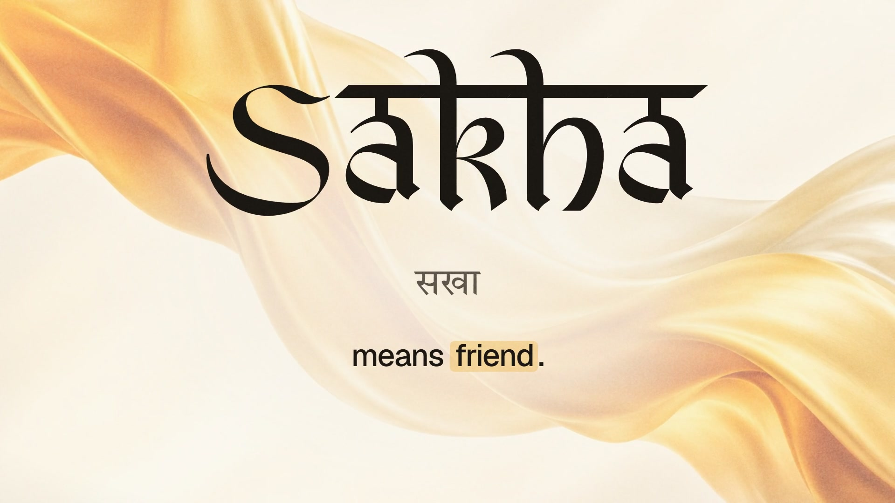

# Sakha · सखा

**A friend for every kind of day.**

Tell Sakha what's weighing on you, in your own words. It listens, then answers with a painted, narrated story from the Indian epics, one real verse from the Bhagavad Gita (cited), and one small step for today.

**Try it:** [sakha.akshatjamwal.workers.dev](https://sakha.akshatjamwal.workers.dev). Desktop and headphones recommended. Say what's on your mind, then watch one story.

[](https://sakha.akshatjamwal.workers.dev)

A concept by Akshat Jamwal, built with Claude Code.

---

## What makes it different

- **No AI service, nothing leaves the page.** The chat runs entirely in the browser (`sakha-site/js/brain.js`). It works offline, and nothing you type is sent anywhere.
- **Stories, not advice.** 14 painted, narrated stories (Arjuna, Meera, Hanuman, Karna, Prahlad and more), each matched to a feeling: afraid, not enough, unwanted, stuck.
- **One real verse, cited.** A story ends on an actual Gita verse with its reference, then one small step to take today.
- **Not a therapist.** Sakha says so, and points people to real help when that's what they need.

## How it's built

A static site: plain HTML, CSS and JavaScript, no framework and no build step.

| File | What it does |
|---|---|
| `sakha-site/js/brain.js` | The offline conversation: reads what you write, picks a reply, a story and a verse |
| `sakha-site/js/stage.js` | One WebGL plane that paints each scene: flow warp, pointer parallax, god rays, ember dissolves, tap ripples |
| `sakha-site/js/story-*.js` | Each story's scene timeline: captions, paintings and narration timing |
| `sakha-site/js/shelf.js` | The story shelf: cloth-bound spines that open into a 3D book |
| `sakha-site/js/folio.js` | A painted peacock that walks through the text, with the lines wrapping around it |
| `sakha-site/js/forms.js` | Gold motes that form a lamp, Krishna's wheel, a peacock feather and ॐ as you scroll |
| `sakha-site/js/audio.js` | Narration, score and ambient bed, with ducking under the voice |
| `stories/` | Story scripts (`*.json`), the narration pipeline (`tts.mjs`, `build-story.mjs`) and a self-check for the chat (`brain-check.mjs`) |
| `film/` | The launch film and the product reel, rendered frame by frame from HTML (see below) |

## Run it locally

Serve the `sakha-site` folder with any static server, for example:

```bash
npx serve sakha-site
```

The display font (Shaka) isn't included in this repo, so headings fall back to a serif font locally. The live site has the real font.

To check the chat's replies:

```bash
node stories/brain-check.mjs
```

## The narration pipeline

`stories/tts.mjs` turns each story's script into narration with Sarvam text-to-speech, and `stories/build-story.mjs` mixes the voice with the score and writes the story's timeline. The API key is read from a `.env` file in the project root (`SARVAM_API_KEY=...`), which is never committed.

## The launch film and reel

Both videos are web pages animated in code, with every frame a pure function of the frame number:

- `film/comp/`: the 52-second launch film, 4:5, cut to the beat of the music
- `film/reel/`: the 30-second product reel, 16:9
- `film/render.mjs`: drives headless Chrome frame by frame, adds motion blur, and joins the frames with ffmpeg
- `film/rec.mjs`: records the real site at phone size, frame-exact, for the footage inside the film

Rendering needs Node, Chrome and ffmpeg. The music tracks aren't included.

## Credits

- Paintings: AI-generated for this project, in a consistent hand-inked style
- Narration: Sarvam text-to-speech
- Music in the site: licensed tracks from Pixabay
